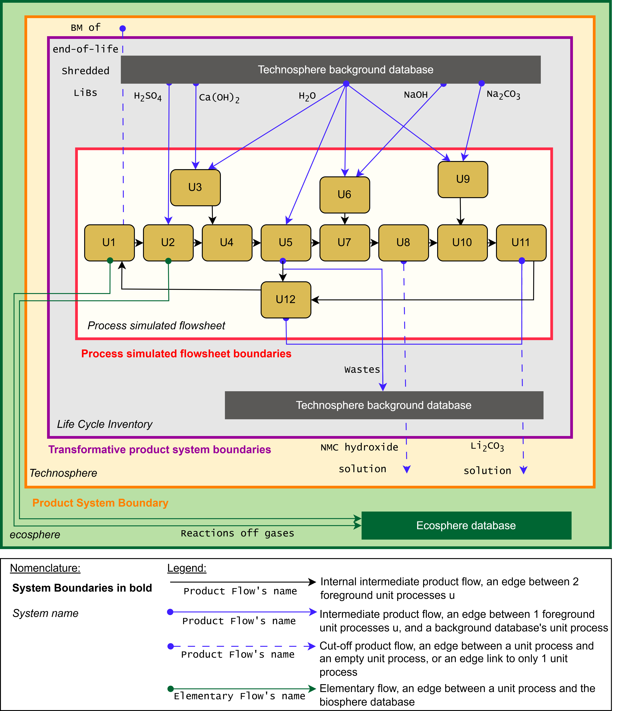

# Quantifying resource dissipation applied to Li-ion battery recycling

Data and code repository for the research article:

> **Quantifying resource dissipation applied to Li-ion battery recycling: Integrating Statistical Entropy Analysis and Exergy Cost Theory Insights into LCA**
> Louis Freboeuf (Univ. Bordeaux, CNRS, Bordeaux INP, ISM, UMR 5255), Yvonne Kaye Perocillo (PEPs, University of Liège), Guido Sonnemann (Univ. Bordeaux, CNRS, Bordeaux INP, ISM, UMR 5255), Angélique Léonard (PEPs, University of Liège), Eric Pirard (GeMMe, University of Liège), Antoine Beylot (BRGM – French Geological Survey).

The article assesses resource dissipation in the hydrometallurgical recycling of Li-ion battery black mass by combining three complementary perspectives: **Statistical Entropy Analysis (SEA)**, **Exergy Cost Theory / Exergy Cost Analysis (ECA)**, and **Life Cycle Assessment (LCA)** with exergy-based resource indicators (Cumulative Exergy Demand, CExD, and Cumulative Exergy Dissipation). The case study is a simulated hydrometallurgical recycling flowsheet of 12 unit processes (U1–U12), from black-mass pulping to lithium carbonate precipitation, transcribed into the Brightway LCA framework under three system-boundary definitions (system-, process- and product-type transcriptions).



*Figure 2: Flowsheet of the hydrometallurgical Li-ion battery recycling process with the different system boundaries (product system, transformative product system, and simulated flowsheet) and the flows linking the unit processes to the technosphere background database (ecoinvent) and the ecosphere.*

## Repository structure

The repository is organised by assessment method. Each Jupyter notebook is self-contained and reads its input data from the folder it belongs to; the code used to generate a manuscript figure is always placed in a section whose title is preceded by the 📰 emoji (e.g. `📰 Figure 4: ...`).

```text
.
├── figures/                          Figure 2: process flowsheet & system boundaries (PNG)
├── sea/                              Statistical Entropy Analysis (SEA)
│   ├── main_sea.ipynb                Main SEA: stage construction, entropy & RSE results
│   │                                 (📰 Figures 3a, 3b and S1)
│   ├── sea.ipynb                     Robustness of the SEA (SM-3) (📰 Figures S2 and S3)
│   ├── sea.xlsx                      Input data: elemental mass balance of the 12 unit processes
│   ├── 32B21520                      Duplicate copy of the sea.xlsx workbook
│   └── results/                      mass_balance_results.xlsx: computed mass balances per stage
├── eca/                              Exergy Cost Analysis (Exergy Cost Theory)
│   ├── traditional_ECA.xlsx          Thermoeconomic ECA model of the flowsheet (traditional approach)
│   ├── residue_ECA.xlsx              ECA model with residue/waste cost allocation
│   └── ModelResults.xlsx             Exergy cost results (flows, streams, processes, unit costs)
├── lca/                              Life Cycle Assessment (Brightway2 / ecoinvent 3.12)
│   ├── LCAs.ipynb                    LCI creation (3 transcription types), LCIA methods
│   │                                 (CExD, CExD+, GWP), LCIA results & contribution trees
│   ├── biosphere_own.xlsx            Custom biosphere flows for the exergy-based indicators
│   ├── readme.md                     Notes on restoring the Brightway2 project backup
│   └── settings.json                 Editor settings (Markdown link validation off)
├── contrib_data/
│   └── contrib_data.xlsx             Contribution analysis input data exported from the
│                                     Activity Browser (beta) "Tiers" panel, used for the
│                                     path contribution analyses of Figures 4, 5, 6 and SM-4
├── contrib_results.ipynb            Path contribution analysis from contrib_data.xlsx
│                                     (📰 Figure 4 and Figure 5)
├── figures_style.py                  Shared matplotlib style and figure export helpers
├── pyproject.toml / uv.lock          Python environment definition (uv)
└── LICENSE                           CC BY 4.0
```

## Requirements and how to run

The notebooks run with Python 3.12 and the dependencies declared in `pyproject.toml` (Brightway2 stack: `bw2data`, `bw2io`, `bw2calc`, `bw-functional`, `wurst`, plus `pandas`, `numpy`, `matplotlib`, `openpyxl`, `mendeleev`). Reproduce the environment with [uv](https://docs.astral.sh/uv/):

```bash
uv sync
uv run jupyter lab
```

Notes:

- `sea/main_sea.ipynb`, `sea/sea.ipynb` and `contrib_results.ipynb` only need the Excel files of this repository and run as-is.
- `lca/LCAs.ipynb` additionally requires a licensed copy of **ecoinvent 3.12** and the Brightway2 project backup of the case study (see `lca/readme.md`). The backup archive and the ecoinvent database are **not** redistributed here because of licence restrictions; the notebook documents how to restore them (`bw2io.backup.restore_project_directory`).
- Figures are exported by `figures_style.py` (`save_figure`) as SVG/EPS (+ CSV of the underlying data) into a local `results` folder.

## License and citation

This repository (code, notebooks and data) is released under the [Creative Commons Attribution 4.0 International (CC BY 4.0)](https://creativecommons.org/licenses/by/4.0/) license — see [LICENSE](LICENSE). The ecoinvent database is not included and remains covered by its own license.

If you use this work, please cite the article and this repository (see [CITATION.cff](CITATION.cff)).
